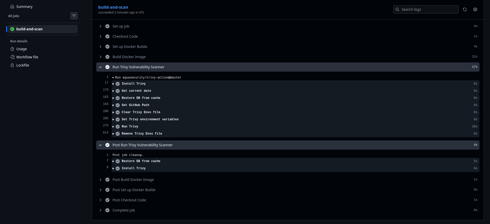
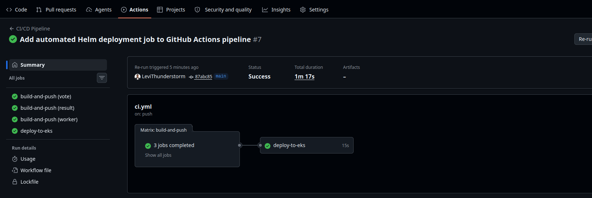

## 🛠️ Deployment Architecture & Operational Workflow

This project implements a **hybrid deployment model**, separating **Infrastructure Provisioning** from **Application Delivery** to ensure a balance between operational speed and financial risk management.

### Architecture Design Rationale
1. **Financial Risk Mitigation (Cost Safety Net):** 
   Infrastructure as Code (Terraform) is purposely executed locally rather than integrated directly into the CI/CD pipeline runners. This eliminates the risk of rogue code pushes or automated triggers accidentally spinning up orphaned production EKS clusters in the cloud, giving the operator absolute control over cloud resource lifecycle and billing.
2. **Automated Application Delivery (CI/CD):** 
   Once the foundational infrastructure is established, GitHub Actions handles application containerization, security scanning (Trivy), and continuous delivery via Helm charts. This ensures rapid iteration on application code without manual packaging overhead.

   Scan
   

   Successful Deployment
   

---

### End-to-End Operational Playbook
Any development engineer or evaluator reviewing this repository can reproduce the complete environment by following this operational sequence:

#### Step 1: Infrastructure Provisioning (Local Control)
Initialize and apply the Terraform configurations locally to provision the VPC, managed EKS cluster, and worker nodes in AWS:
```bash
cd terraform/
terraform init
terraform apply --auto-approve

```

*Once the cluster is active, configure your local Kubernetes context:*

```bash
aws eks update-kubeconfig --region us-east-1 --name <your-cluster-name>

```

#### Step 2: Automated Application Deployment (CI/CD + Helm)

With the cloud infrastructure running, push application updates or configuration files to the repository:

```bash
git add .
git commit -m "Deploy application updates"
git push origin main

```

* **What happens behind the scenes:** The GitHub Actions pipeline triggers, builds the container images for all microservices (`vote`, `result`, `worker`), scans them for vulnerabilities using Trivy, and automatically executes `helm upgrade --install` to deploy the fresh images onto the active EKS cluster.

#### Step 3: Lifecycle Teardown & Cost Optimization

To prevent ongoing billing charges when testing is complete, tear down all cloud infrastructure cleanly from your local terminal:

```bash
cd terraform/
terraform destroy --auto-approve

```