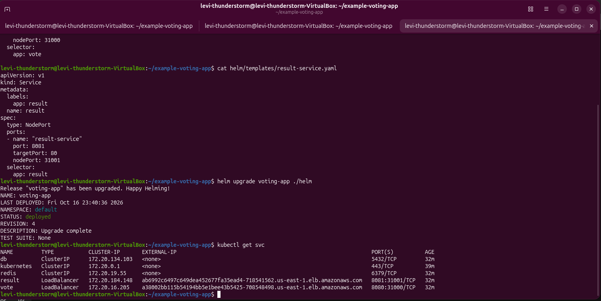

# Cloud-Native Microservices Deployment on AWS EKS

## 1. Project Overview
A production-grade, containerized multi-tier application (**Example Voting App**) deployed onto a managed Kubernetes cluster on Amazon Web Services (AWS) using Infrastructure as Code (Terraform), Helm package management, and cloud-native load balancing.

---

## 2. Architecture & Tech Stack
* **Cloud Provider:** AWS (`us-east-1`)
* **Infrastructure Provisioning:** Terraform (VPC, EKS Cluster, Managed Node Groups)
* **Orchestration & Packaging:** Kubernetes & Helm Charts
* **Application Components:**
  * **Vote (Frontend):** Python web application where users cast votes.
  * **Redis (Queue):** In-memory data store holding raw votes temporarily.
  * **Worker (Backend):** Background service consuming votes from Redis and persisting them.
  * **PostgreSQL (Database):** Persistent relational database for aggregated votes.
  * **Result (Frontend):** Node.js web application displaying real-time vote tallies.

---

## 3. Architecture Flow
```text
[ Users / Browser ] 
        │
        ▼ (AWS Elastic Load Balancer / Public URL)
   ┌─────────┐         ┌───────┐         ┌────────┐         ┌────────────┐
   │  Vote   │ ──────> │ Redis │ ──────> │ Worker │ ──────> │ PostgreSQL │
   └─────────┘         └───────┘         └────────┘         └────────────┘
                                                                  ▲
                                                                  │
                                                           ┌─────────────┐
                                                           │ Result (UI) │ ──> [ Public URL ]
                                                           └─────────────┘

```

---

## 4. Deployment & Reproducibility Guide

Anyone cloning this repository can provision the identical environment in their own AWS account by following these steps:

### Prerequisites on your local PC

* AWS CLI configured with active credentials (`aws configure`)
* Terraform installed
* `kubectl` and `helm` installed

### Step-by-Step Deployment

1. **Provision Infrastructure (Terraform):**
```bash
cd terraform/
terraform init
terraform apply --auto-approve

```


2. **Configure Kubernetes Context:**
```bash
aws eks update-kubeconfig --region us-east-1 --name <your-cluster-name>

```


3. **Deploy Application via Helm:**
```bash
helm upgrade --install voting-app ./helm

```


---

## 5. Public Access & Verification

To expose the services externally via AWS Elastic Load Balancers, the Kubernetes services (`vote` and `result`) were configured as `type: LoadBalancer`.

Retrieve your dynamic public endpoints:

```bash
kubectl get svc

```
Kubectl Successful 

* **Voting App URL:** `http://<YOUR-VOTE-ELB-URL>:8080`
* **Results App URL:** `http://<YOUR-RESULT-ELB-URL>:8081`


---

## 6. Resource Teardown

To prevent ongoing AWS billing, tear down all provisioned cloud infrastructure cleanly:

```bash
cd terraform/
terraform destroy --auto-approve

```
